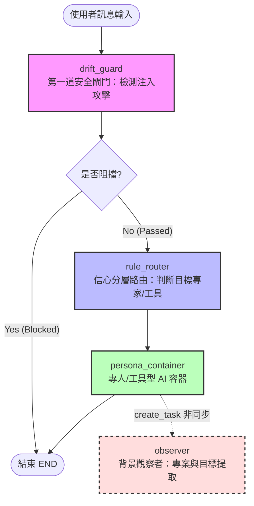
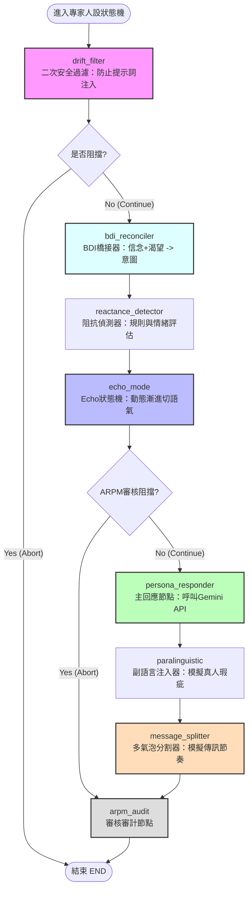
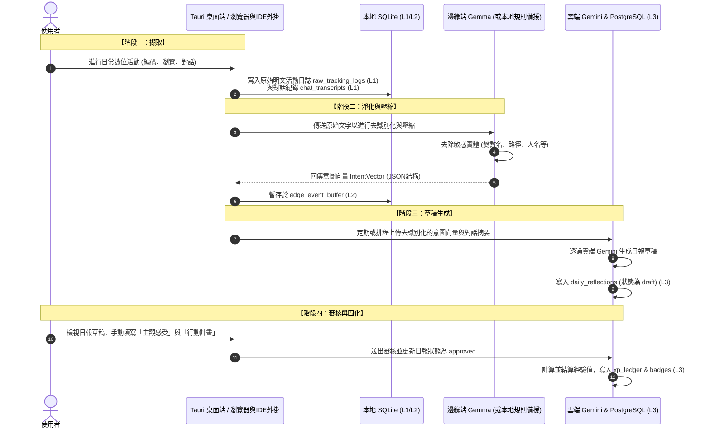

# coOS — 智慧共盟生活導航系統：一套對抗 AI 時代心理失衡的隱私優先半自動化諮商同盟

**114-2 生成式人工智慧導論應用實作專題**


---

## 摘要

人工智慧的快速普及在提升生產效率的同時，也對使用者的心理健康造成了反噬：憂心被取代的焦慮、過度依賴 AI 產出的空虛與冒牌感、以及內在目標被效率主義稀釋的意義感缺失。本專題提出並實作 **coOS（智慧共盟生活導航系統）**，試圖以一套「長期、半自動化的諮商同盟與生活檢核系統」回應上述痛點。

coOS 的核心設計理念是「**以半自動化與微摩擦力的產品設計，減輕使用者自我記錄的意志力負擔**」。傳統生產力工具仰賴使用者主動投入心力進行記錄與反思，一旦動力耗盡便宣告失效；coOS 則被動觀察使用者的數位行為足跡，由人工智慧代勞客觀活動描述的撰寫，僅將「主觀感受」與「行動計畫」這類具反思價值的環節保留給使用者，藉由刻意設計的「微摩擦力」喚起慢思考。系統同時整合視覺化成就回饋、角色情境隔離、擬真人性的專家對話與真人同儕社群，從多重心理機制共同支撐使用者的長期投入動機。

在工程架構上，coOS 採用「邊緣—雲端混合之多智能體架構」。最敏感的原始明文資料（如原始程式碼、瀏覽器內容、背景遙測）永久保存於本地裝置；經由區域網路內的端側小型語言模型過濾與壓縮為去識別化的意圖與情境摘要後，才與雲端大型語言模型協作。此設計使系統得以在兼顧資訊安全的前提下，仍享有雲端模型的深層認知與語意提煉能力。

本系統由臨床心理學、認知科學與人機互動、生成式人工智慧工程與資訊隱私四個領域交會而成，並以最小可行產品(MVP)為目標完成了端側感知、邊緣壓縮、隱私防禦、多智能體對話、半自動日報與真人社群六大支柱的閉環實作。本報告以作者本人連續十二日的實際使用日誌（逾一萬五千筆遙測、一千八百餘筆意圖向量）對系統的工程行為進行了初步量測，驗證了邊緣去識別化與分層降級機制的可行性。須誠實指出的是，本專題的貢獻定位於「設計與工程實作」層次：上述心理機制的設計理念雖有文獻依據，但其對使用者心理健康的實際效益尚待後續具對照組的使用者研究驗證，本報告不宣稱已證實此類效益。

**關鍵詞**:人工智慧焦慮、混合主動式人機互動、邊緣—雲端協同推論、阿德勒社會情懷、動機式晤談、多智能體系統、語意壓縮、隱私防禦設計

---

## 目錄

1. 緒論：題目發想與動機
2. 跨域創新：痛點剖析與解方對應
3. 相關研究與理論基礎
4. 系統架構設計
5. 核心功能與實作成果
6. 隱私保護機制
7. 開發方法
8. 評估與成果
9. 限制與未來展望
10. 結論
11. 參考文獻

---

## 1. 緒論：題目發想與動機

### 1.1 問題背景

生成式人工智慧在近年的爆發式發展，深刻改變了知識工作者的日常。然而在效率提升的表象之下，愈來愈多使用者承受著由 AI 帶來的心理壓力。本專題將這些壓力歸納為三種典型樣態：

- **焦慮感與無力感**：憂心自身工作被 AI 取代，或在「比拚誰更會用 AI」的氛圍中感到追趕不及。
- **空虛感、冒牌感與罪惡感**：習慣以 AI 快速產出成果，使用者逐漸對「成果是否真正出於自己」產生懷疑，削弱了努力應有的踏實感。
- **意義感缺失**：當存在價值被工具所稀釋、生活又缺乏內在追尋的目標時，人容易陷入方向感的喪失。

這些問題的共同根源，在於**人與自身努力之間的連結被效率主義切斷**。使用者不再經歷「投入—反思—成長」的完整歷程，也因此失去了由此歷程所產生的自我價值感。

### 1.2 核心命題

本專題主張，既有生產力與自我管理工具之所以難以長期奏效，是因為它們把記錄、反思與堅持的全部認知負荷交付給使用者的「個人意志力」，而意志力是一種會隨時間與心智負荷耗竭的有限資源。一旦意志力耗盡，使用者便會中斷記錄，導致系統徹底失效（即「動力耗竭」的失效模式）。

coOS 的設計試圖轉換此失敗模式：

> 傳統工具因要求強大意志力而容易導致「動力耗竭」的不可逆失效；coOS 則將負擔轉移給系統，使因不便使用而中斷的狀況被定位為「系統流程的設計缺陷」，從而能夠透過疊代開發與工程優化來持續改良。

由此衍生出本專題最關鍵的設計悖論——**自動化的兩難**。若系統完全代替使用者完成記錄與反思，將剝奪使用者對自身成長的「心理所有權」，反思淪為被動接收而失去意義；若系統完全要求使用者手動完成，則勢必落入「記錄疲勞」的窠臼。coOS 的解法是**「半自動化與微摩擦力反思」**：由系統承擔繁瑣的客觀事實捕捉（由背景遙測代勞），而把真正需要使用者主觀投入的部分（如情緒特徵命名、行動計畫承諾）以必填欄位的形式保留下來。這種最小限度的「摩擦」成為觸發深度慢思考的設計特徵，而非待消除的缺陷。

### 1.3 解方構想

基於上述命題，coOS 被設計為一套整合多重心理機制的長期陪伴系統，其五項支柱為：

1. **半自動捕捉與微摩擦力反思**——降低記錄門檻，同時保留反思的主動性，提升使用者的踏實感與目標對齊。
2. **視覺化成就與遊戲化回饋**——以成就感與敘事化回顧驅動使用者的好奇心、主動性與長期黏著。
3. **角色情境隔離**——將個人身分、AI 專家角色與專案分流管理，協助使用者在 AI 無所不在的環境中重建生活與工作的邊界。
4. **擬真人性的專家對話**——讓 AI 以近似諮商關係的方式與使用者互動，透過社會承諾與同理心制約協助提問與梳理。
5. **真人同儕社群羈絆**——藉由凝聚的人際關係，提升使用者的共好、分享與意義感。

---

## 2. 跨域創新：痛點剖析與解方對應

coOS 的創新性不在於單一技術的突破，而在於將多個原本互不相干的學科整合成一套自洽的系統。下表呈現使用者痛點與系統解方的對應關係，以及各解方所倚賴的學科基礎：

| 使用者痛點 | 系統解方 | 學科基礎 |
|------------|----------|----------|
| 追求效率與比拚工具所造成的焦慮、無力與冒牌感 | 微摩擦力日報：半自動捕捉與反思，讓使用者輕易完成每日回顧 | 認知科學（認知負荷理論、反思學習） |
| 存在價值被取代導致的空虛與意義感缺失 | 視覺化成就與敘事化回顧，以成就感與意義建構驅動長期動力 | 動機心理學（自我決定理論、心流理論） |
| 工具無所不在導致的生活與工作邊界模糊 | 角色情境隔離：身分、專家與專案的清晰切分 | 自我概念心理學（自我複雜度理論） |
| 缺乏真實情感交流造成的社會情懷斷裂 | 真人社群羈絆、承諾公開質押與社群共同挑戰機制 | 個體心理學（阿德勒心理學之「社會情懷」）、社會心理學（社會承諾） |
| 面對系統或 AI 介入時產生的心理抗拒與防衛機制 | 擬真人性專家對話、抗拒偵測與 Echo Mode 語氣漸進切換 | 臨床心理學與人機互動（諮商同盟、勸導式科技、動機式晤談 OARS 技術） |

這個多象限的對應關係本身即是本專題的核心貢獻：它將一個模糊的「AI 時代心理健康」議題，拆解為五個可被獨立設計與驗證的子問題，並為每個子問題找到了具體的理論依據與工程實作路徑。市面上既有的工具往往只能處理其中一兩個面向，而 coOS 試圖以一套整合系統同時涵蓋全部面向，並以隱私架構作為貫穿其間的信任基礎。

---

## 3. 相關研究與理論基礎

本專題在設計階段大量參考了心理學、人機互動與生成式人工智慧領域的研究成果，以確保每一項設計決策都有理論支撐。以下依主題分述其中最關鍵的理論來源。

### 3.1 半自動記錄與反思的認知科學基礎

人機互動領域對「混合主動式介面(mixed-initiative interface)」的研究指出，當系統與使用者共同完成一項任務時，任務的分工方式會深刻影響使用者對成果的擁有感。認知負荷理論(Cognitive Load Theory)主張，學習與反思的深度取決於使用者投入的心智努力；若系統替使用者完成了所有思考，反思的價值便不復存在。

行為經濟學中的「IKEA 效應」進一步說明，人們對於自己參與製作的事物會賦予更高的價值。coOS 據此在日報設計中刻意保留必填的主觀欄位：系統可以代勞客觀活動的描述，但「當下的感受」與「下一步行動」必須由使用者親手填寫。這種刻意設計的「微摩擦力(design friction)」並非介面的缺陷，而是促使使用者由直覺式的快思(System 1)切換為審慎的慢想(System 2)、進而產生有意義反思的關鍵手段。系統並參考吉布斯反思循環(Gibbs' Reflective Cycle)的結構來組織反思引導的問句。

此外，在「何時打斷使用者」的問題上，本專題採納了「延遲至斷點(defer-to-breakpoint)」的原則：系統不在使用者處於高度專注的工作狀態時推送通知，而是等待自然的任務切換時機，以避免破壞性打斷與隨之而來的恢復延遲，並防範醫療級介面研究所警示的「警報疲勞」。

### 3.2 動機與長期投入的心理學基礎

為支撐使用者的長期投入，coOS 整合了三套互補的動機理論。**自我決定理論(Self-Determination Theory)**指出，自主、勝任與連結三項基本心理需求的滿足，是內在動機的來源；系統的角色自主切換、成就回饋與社群連結分別呼應這三項需求。**福格行為模型(Fogg Behavior Model)**將行為的發生條件描述為動機、能力與提示三者的交集，指導了系統在適當時機以適當門檻提示使用者行動的設計。**心流理論(Flow Theory)**與「近側發展區(Zone of Proximal Development)」概念則提醒系統應提供難度適中的挑戰，使任務既不致過難與引發焦慮，也不致過易而流於無聊。

同時，本專題特別警惕遊戲化機制的反面風險。借鏡對情感型聊天應用(如 Replika)的擬社會依附研究，系統將遊戲化的多巴胺刺激整量限制在「使用者主動觸發」的範圍內，並以一組「反指標」自我監督——例如抽卡頻率異常升高、登入天數高但情緒分數持續下降等現象，皆被視為病態使用的警訊而非成功指標。

### 3.3 角色一致性與擬真對話的理論基礎

擬真的 AI 專家對話是 coOS 維繫長期陪伴關係的核心。本專題借用臨床心理學中「治療同盟(working alliance)」的三項結構要素——目標共識、任務共識與情感連結——作為設計與衡量 AI 專家互動品質的指標。須強調的是，「治療同盟」原為描述真人治療師與案主之間關係的建構，本專題僅將其三要素挪用為設計參照，並不主張 AI 對話達成了臨床意義上的治療同盟；系統定位為日常自我反思的陪伴工具，而非任何形式的醫療或心理治療。在對話技術上，系統借鑑了**動機式晤談(Motivational Interviewing)**的 OARS 技術組(開放式提問、肯定、反映式傾聽、摘要)：當偵測到使用者出現心理抗拒時，AI 不會急於給出建議，而是改採反映式傾聽並順勢而行，以化解阻抗。

為避免長對話下常見的「人設漂移」，系統採用結構化的角色設定：以五因子人格模型(OCEAN)描述專家性格，以「形成性經歷」與「知識邊界」界定角色的背景與所知範圍(超出邊界即坦承不知並轉介)，並以分層記憶機制管理長期一致性。這些做法分別呼應了角色扮演語言模型與生成式代理人(generative agents)的相關研究，後者提出以「新近性、重要性、相關性」三項分數檢索記憶、並定期將觀察昇華為高階洞察的機制。系統同時納入反諂媚(anti-sycophancy)的設計守則，使專家在使用者意見與其立場衝突時，能溫和而堅定地維持立場，而非一味附和。

在「跨越恐怖谷」方面，本專題引入計算心智理論(Theory of Mind)與副語言線索的研究發現：適度的語言不完美(如偶發的填充詞、自我修正)反而能提升 AI 的真實感，進而誘發使用者「不願辜負」對方的責任心。一項關鍵的反直覺設計是：AI 專家絕不直接鏡像使用者的負面情緒(使用者焦慮時 AI 不應跟著焦慮)，而應扮演安撫與穩定的角色。

### 3.4 深層心理建模：薩提爾冰山模型

為使系統能對使用者進行深層的心理覺察，coOS 在進階規劃中採用了家族治療大師維琴尼亞·薩提爾(Virginia Satir)提出的**冰山模型**。該模型主張，人外顯的「行為」只是冰山一角，水面下依序隱藏著應對姿態、感受、觀點、期待、渴望與自我等層次。系統將這七個層次結構化為知識圖譜的節點，並以版本控制紀錄等「數位表型(digital phenotype)」作為推論行為背後心理狀態的線索。薩提爾理論中的五種應對姿態(指責、討好、超理智、打岔、表裡一致)則成為建模使用者溝通模式的依據。

由於讓 AI 推論他人的內在心理狀態具有高度風險，系統特別設計了「心理幻覺防禦」機制：任何由雲端模型推論出的心理洞察，都必須與本地的客觀行為紀錄進行邏輯對照，通過符號層級的驗證後才得以採納，以避免 AI 對使用者進行缺乏根據的過度詮釋。

### 3.5 端側語意壓縮與隱私防禦

在隱私工程方面，本專題的核心技術設計原規劃採用近年端側小型語言模型（SLM）的「軟提示詞（Soft Prompt）遷移」技術，即將原始文本編碼為連續的數值向量表徵後直接傳入雲端模型。然而，由於目前主流的雲端大型語言模型（如 Gemini 系列）均為閉源 API，無法直接接收或解析自訂的數值向量特徵作為 Transformer 層輸入。

因此，本系統在工程實作上進行了務實的妥協，改採用**「硬提示詞語意壓縮（Hard-Prompted Semantic Compression）」**技術：由部署在邊緣端的 Gemma 模型作為隱私過濾關卡，將本地敏感的明文日誌（包含代碼細節、具體網址等）轉譯並壓縮成**去識別化的結構化意圖與情境摘要（Intent Vector，以 JSON 格式表示）**。此 JSON 結構僅包含泛化的意圖標籤（如 `coding`、`browsing_docs`）、去識別化的高階語意摘要（不含人名、具體專案路徑、密鑰等敏感實體）以及 Valence-Arousal 情緒指標。此一結構化數據再作為雲端 LLM 的提示詞協作輸入。此種做法既繞過了閉源 API 的限制，又從架構上避免了明文直接上雲的安全威脅。

須誠實界定此一妥協對隱私強度的影響:原規劃的軟提示向量遷移,其隱私性訴求在於「上傳的是連續向量、難以直接閱讀」;而改採的硬提示 JSON 摘要,本質上是**人類可讀的自然語言**,其去識別化程度因此完全取決於 Eguard 過濾與 Gemma 壓縮的實際效果,而非任何密碼學或不可逆性的保證。換言之,本系統提供的是「自然語言層級的去識別化」,而非「表徵不可還原」。值得一提的是,即便是原規劃的向量路線亦非萬無一失:已有研究指出文字嵌入向量可被反推出接近原文的內容,因此「僅傳向量」本身並不等同於隱私安全。本專題對 L2 摘要的去識別化效果提供了初步的實證量測(見第 8.2 節),但對嵌入逆向類攻擊的形式化防禦,則列為後續課題(見第 9 節)。

---

## 4. 系統架構設計

### 4.1 邊緣—雲端混合之多智能體四層架構

coOS 採用四層分層式架構，每一層都有明確的職責與隱私邊界，確保在保護隱私的同時提供強大的智慧反思與陪伴能力。

- **第一層:端側感知與介面層。** 以本機筆電為載體，採用 Tauri 與 React 技術建構跨平台桌面應用，並包含 VSCode 插件與 Chrome 瀏覽器插件，負責監聽並收集使用者的數位行為足跡並呈現主要介面。最敏感的原始明文資料（如對話逐字稿、未過濾之遙測記錄）均直接保存於本機的 SQLite 資料庫中。
- **第二層:邊緣推論與隱私層。** 以區域網路內的本機平板或邊緣端（如 M1 iPad 或本機 Ollama 執行個體）為載體，部署量化後的端側小型語言模型（Gemma）。此層的職責是將第一層傳入的原始敏感明文進行「去識別化過濾與硬提示詞語意壓縮」，消除檔案路徑、變數名稱與個人標識符，並輸出為去識別化的 JSON 格式意圖特徵。
- **第三層:混合式多智能體層。** 以 Python 後端服務（FastAPI）搭配多智能體編排框架（LangGraph）實作，負責核心業務邏輯、AI 專家的對話編排、認知斷點偵測與背景維護排程。在 MVP 階段以本機常駐 Sidecar 服務的形式運行。
- **第四層:深層認知與動態圖譜層。** 結合雲端大型語言模型（Gemini）、圖形資料庫（Neo4j）與雲端關聯式資料庫（Supabase PostgreSQL），負責薩提爾冰山圖譜建模、高難度日報總結、以及跨裝置之業務狀態同步。

### 4.2 資料傳輸淨化與隔離原則

系統的資料保護設計遵循「資料由內向外、由敏感向去敏感單向流動，且敏感明文絕不上雲」的原則：本地明文日誌在邊緣端經去識別化過濾並壓縮為 JSON 意圖特徵，經雲端 Gemini 提煉為日報草稿，最終只有經使用者人工審查核准的去識別化日報內容、經驗值與徽章等業務狀態，才會同步寫入雲端的 Supabase PostgreSQL 中。第四層的雲端服務在物理架構上無法反向存取第一層與本地的原始敏感明文。

### 4.3 資料的隱私分級

為實踐資料隔離，系統將所有資料分為三級，規定不同的儲存位置與傳輸限制：

| 隱私層級 | 內容範例 | 儲存位置 | 傳輸規則 |
|----------|----------|----------|----------|
| 明文 (L1) | 原始程式碼、對話逐字稿、瀏覽器網址與內容 | 本地 SQLite 資料庫 | 嚴禁離開本機裝置 |
| 意圖表示 (L2) | 經邊緣模型去識別化壓縮後的 JSON 意圖與情緒特徵 | 本地 SQLite 暫存緩衝區 | 僅傳輸去識別化的結構文本 (JSON) |
| 業務狀態 (L3) | 經驗值、解鎖徽章、日報草稿與已核准日報、AI人設 | 雲端 PostgreSQL 資料庫 | 允許雲端儲存與跨裝置同步 |

### 4.4 因應資源限制的工程取捨

由於本專題以學生個人開發資源完成，在設計時對運算成本與回應延遲進行了工程折衷。在 AI 專家路由的觸發機制上，系統優先採用本機規則式預判，而將較耗資源的「LLM 信心分流裁判」作為補充方案。在因應雲端模型的免費呼叫額度限制上，系統依任務複雜度將推理需求分為四個層級，動態選用最適模型，並在遭遇 API 限制或超時（如 HTTP 429 或 503）時，自動向下一層級的備援模型進行容錯轉移（Failover），以維持系統高可用性：

| 層級 | 適用任務 | 首選模型 | 容錯轉移備援路徑 |
|------|----------|----------|----------|
| 第一層 | 個人隱私資訊遮蔽、遙測過濾 | 雲端 Gemma / 本地正則過濾 | 本地規則過濾 |
| 第二層 | 背景路由驗證、初步意圖分類、日報卡片生成 | Gemini Flash Lite | 雲端 Gemma / 本地規則提取 |
| 第三層 | AI 專家對話、主路由判斷 | Gemini Flash | Gemini Flash Lite |
| 第四層 | 每日深度反思總結、薩提爾圖譜寫入與驗證 | Gemini Pro | Gemini Flash |

### 4.5 資料庫設計

coOS 的資料儲存架構實施了「雙庫物理隔離設計」：本地端採用 SQLite 用於保護使用者高敏感的數位足跡與對話逐字稿，雲端則採用 Supabase PostgreSQL 來儲存去識別化後的業務狀態、社群質押與經驗值。以下為核心資料表之結構設計與隱私層級對照：

| 資料庫類型 | 資料表名稱 | 隱私層級 | 核心欄位與外鍵關係 | 儲存目的與隱私約束 |
|------------|------------|----------|--------------------|--------------------|
| **本地端 SQLite**<br>(永久保留於本機，不外傳) | `raw_tracking_logs` | L1 (明文) | `id`, `event_type`, `payload` (JSON 格式 OS 遙測內容), `recorded_at` | 監聽並保存原始 OS 焦點切換、編碼狀態等未過濾資料。 |
| | `chat_transcripts` | L1 (明文) | `id`, `role_id`, `content` (逐字稿), `audio_path`, `paralinguistic_metadata` | 保存使用者與 AI 專家的對話紀錄。 |
| | `edge_event_buffer` | L2 (意圖) | `id`, `source_log_id`, `intent_vector` (JSON 格式去識別化摘要), `is_synced` | 暫存經邊緣 Gemma 語意壓縮後的意圖特徵，作為與雲端協作的緩衝區。 |
| | `role_implicit_states`| L2 (意圖) | `id`, `role_id`, `label` (疲勞/專注等), `valence`, `arousal` | 記錄使用者角色隱性情緒指標（Valence-Arousal 二維情感模型）。 |
| **雲端 Supabase**<br>**PostgreSQL**<br>(支援多端同步與社群) | `users` / `roles` | L3 (狀態) | `id`, `current_xp`, `lifetime_xp` (累積經驗值), `level`, `active_role_id` | 管理使用者帳戶狀態與目前切換的角色類型。 |
| | `ai_experts` | L3 (狀態) | `id`, `name`, `personality_prompt`, `backstory`, `tone_default`, `trust_level` | 存放 AI 專家的結構化人設設定（BDI 基礎）。 |
| | `role_projects` | L3 (狀態) | `id`, `role_id`, `name`, `status`, `inferred_by_ai` (AI 探索旗標) | 使用者目前的專案/學業看板，支援 AI 自動提取與手動管理。 |
| | `daily_reflections` | L3 (狀態) | `id`, `user_feeling` (主觀感受), `user_action_plan` (行動計畫), `is_reviewed` | 儲存日報主表。主觀反思欄位須使用者親手填寫始能核准。 |
| | `daily_reflection_segments` | L3 (狀態) | `id`, `reflection_id`, `safe_summary` (去識別化摘要), `activity_minutes` | 儲存日報的時段分解。僅同步去識別化泛化後的安全版本。 |
| | `xp_ledger` | L3 (狀態) | `id`, `user_id`, `amount`, `xp_type` (earned/spent), `reason` (業務原因描述) | 經驗值異動明細帳本，用以確保 XP 異動有據可循，[RISK-12] 規定限制禁止寫入明文。 |
| | `m6_6_communities` 等 | L3 (狀態) | `id`, `name`, `m6_6_social_posts`, `m6_6_stakes` (承諾質押金額) | 社群互動、成員列表、公開貼文以及經驗值質押承諾。 |

在資料庫設計與實作中，包含以下兩項核心設計機制：
1.  **經驗值帳本（XP Ledger）不可逆性與等級保護**：
    系統實施了「歷史累積經驗值（`lifetime_xp`）只增不減」的設計（由後端 `XPGatekeeper` 與資料庫級約束強制保證）。當使用者在社群中進行「承諾質押」或「兌換獎勵」等花費行為時，系統只會扣減可用經驗值（`current_xp`），絕不扣減用以計算等級的 `lifetime_xp`。這保證了使用者的等級永遠不會倒退，從而避免了心理學上的損失厭惡造成動機挫折。
2.  **日報時段子表的雙版本語意設計**：
    `daily_reflection_segments` 中區分為本地端細節版本與雲端安全同步版本。當本地桌面端顯示時，能從 SQLite 中聯結查詢詳細的活動軌跡；但當日報上傳同步至 Supabase 時，後端 API 白名單限制僅能上傳經邊緣 SLM 泛化去識別化後的安全版本（如 `safe_summary` 為「進行資訊工程學術研究」，而非包含具體連結的明文），確保敏感活動隱私不會外洩。

### 4.6 多智能體 Agent 流設計

系統的第三層核心是以 LangGraph 框架編排的巢狀多智能體狀態機。系統的對話流程分為外層的「路由協調圖」與內層的「專家人設狀態機」，藉由雙層解耦設計，將「意圖與安全分流」和「具體諮商角色表現」獨立處理。



#### 4.6.1 外層：路由協調圖（M4.1 Router Graph）
當使用者送出訊息時，會進入頂層協調路由圖（實作於 `m4_1_router/graph.py`）：
1.  **安全過濾節點（`drift_guard`）**：調用安全過濾（`drift_validate`），檢測使用者輸入是否包含惡意提示詞注入攻擊（Prompt Injection），若判定為惡意則直接流向結束（`END`）。
2.  **規則分流路由節點（`rule_router`）**：依據使用者的目前角色設定、邊緣端回傳的意圖特徵，判斷應路由給哪位 AI 專家（如「資工學長」、「諮商心理師」）或通用的「工具型 AI 助理」。若前端已由使用者明確選定特定專家，則直接繞過路由判定。
3.  **人設容器節點（`persona_container`）**：
    *   若分流至**工具型 AI 助理**，則以客觀、中立、詳盡的系統提示詞呼叫雲端模型生成回應，並於最末端自動偵測是否需建議使用者點擊配對特定領域的專家。
    *   若分流至**特定 AI 專家**，則將狀態傳遞並啟動內層的「專家人設狀態機」。
    *   **非同步觀察者派發（`_dispatch_observer_bg`）**：在交付對話的同時，以 `asyncio.create_task` 於背景非同步派發觀察者模組（`m4_6_observer`），從對話中提煉潛在的專案與目標承諾，寫入 L3 資料庫，此過程完全不阻塞主對話流程。



#### 4.6.2 內層：專家人設狀態機（M4.2 Persona Graph）
專家的每一則回應都需通過精細的狀態處理鏈（實作於 `m4_2_persona/graph.py`），以落實長期陪伴的一致性與防護同理心失真：
1.  **二次安全過濾節點（`drift_filter`）**：在專家端再次過濾 Prompt 注入，阻斷風險。
2.  **信念-渴望-意圖橋接節點（`bdi_reconciler`）**：基於 BDI 代理人模型，將專家的「信念（Belief，如：使用者今天編碼受挫）」與「渴望（Desire，如：提供引導）」進行語意橋接，轉化為「行動意圖（Intention）」，避免直接拼接導致的同理心失靈。
3.  **阻抗偵測節點（`reactance_detector`）**：分析使用者輸入中的情緒指標（如 Valence-Arousal 分數與抗拒性詞彙），評估使用者是否出現心理阻抗（Reactance）。
4.  **語氣漸進調整狀態機（`echo_mode`）**：根據阻抗偵測結果，動態切換專家語氣（Echo Mode）。若偵測到使用者高度防衛，系統會將專家從主導性的「權威（Authoritative）語氣」逐步降級至「同理（Empathetic）語氣」，藉由降低主導性來化解阻抗。此狀態轉移受 Agent Reactance Protection Module (ARPM) 檢驗，防止語氣突變（人設崩壞）。
5.  **主回應節點（`persona_responder`）**：編譯結構化的 PersonaCard 資訊，注入 BDI 意圖、薩提爾隱性情感狀態，並結合動機式晤談（Motivational Interviewing）之 OARS 技巧，呼叫雲端 Gemini API生成回應。回答規則明訂限制長度（3句以內）、編碼防衛限制，且一則回覆只問一個問題，以模擬真人的傳訊節奏。
6.  **副語言瑕疵注入節點（`paralinguistic`）**：視專家審核與信任程度（Trust Level）在回應中隨機注入自然的副語言瑕疵（例如：「嗯...」、「那個...」），以跨越恐怖谷，增強對話真實性。
7.  **多氣泡分割節點（`message_splitter`）**：依據回應長度與句讀，將生成內容拆分為 1 至 4 個獨立的氣泡，並依字數計算發送延遲（`delay_ms`），模擬真人打字發文的互動感。
8.  **審計與自相矛盾檢測節點（`arpm_audit`）**：記錄狀態轉移事件；同時調用 `ClaimLedger` 背景分析專家作出的事實宣告，若與過往記憶庫自相矛盾，則觸發防人設漂移警報，用以維持角色一致性。

### 4.7 資料流設計

系統的資料流遵循「本地擷取 -> 邊緣去識別 -> 雲端草稿 -> 人工核准固化」的生命週期，整體資料處理路徑如下圖所示：



1.  **階段一：端側遙測監聽與擷取（Capture）**
    由 Tauri 整合的 Rust Telemetry Daemon（實作於 `m1_1_telemetry_daemon` 目錄，主要是 `m1_1_1_uiautomation.rs` 與 `m1_1_3_focus_tracker.rs`）在啟動時拉起。該程式被動監聽系統焦點視窗事件，透過 Windows 的 UI Automation 取得當前應用程式進程名稱（Image Name）與視窗標題。同時，VSCode 外掛與瀏覽器外掛將編碼行數、存取文件等數據，非同步發送至後端端點。此階段擷取的所有原始日誌明文一律寫入本地 SQLite 的 `raw_tracking_logs` 中。
2.  **階段二：去識別化過濾與硬提示語意壓縮（Sanitization & Compression）**
    遙測明文日誌在寫入後，會先進入 `m2_1_event_debouncer` 進行時間滑動視窗去重與防抖。隨後，資料被送入 `m2_3_eguard`（隱私淨化引擎），該引擎會掃描並屏蔽 Email、API 金鑰、個人身分證號及本機檔案路徑等資訊（例如在程式代碼上下文排除 localhost 迴路 IP 的過度屏蔽），並遵循 `.eguardignore` 行為規則。過濾後的文本傳送給區域網路內 iPad 上運行的 Gemma 模型（或本機 Ollama），壓縮提煉為去識別化的 JSON 格式意圖特徵（`IntentVector`），並暫存於本地的 `edge_event_buffer` (L2)。
3.  **階段三：日報草稿生成（Draft Generation）**
    系統每天深夜啟動定期排程（`draft_cron_loop`）。背景任務讀取當日累積的 L2 意圖特徵與已結束的對話摘要（由 `ChatCompressor` 完成語意壓縮），呼叫雲端 Gemini模型將零碎活動合成為一份結構化的日報草稿。該草稿包含時段拆分、客觀活動描述，寫入雲端 PostgreSQL 的 `daily_reflections` 資料表，其狀態被設定為 `is_draft=True`。
4.  **階段四：人工核准與 ACID 結算（Audit & Settlement）**
    使用者在 UI 界面中打開日報，此時會觸發**微摩擦力設計**——使用者必須親手在日報中輸入**「主觀感受（user_feeling）」**與**「行動計畫（user_action_plan）」**，才能點擊「核准日報」。
    後端接收到核准請求時，會調用 `XPGatekeeper` 服務層（`gatekeeper.py`）進行嚴格的 **ACID 事務性結算**：
    *   **計算所得經驗值**：根據客觀活動時數計算基礎 XP（每小時 25 XP），若活動對齊專家目標則乘以 $1.5$ 倍；若填寫了學習收穫則額外 $+10$ 點固定紅利；若使用者審閱日報停留時間超過 15 秒（Deep Consideration），則每秒發放 $0.1$ XP 紅利（上限 300 秒，防止掛機刷分）。
    *   **三重守門防禦**：必須滿足 `is_draft=False`、`is_reviewed=True`，且 `user_feeling` 與 `user_action_plan` 均非空，否則後端拒絕發放，從工程上保證「無反思即無經驗值」的動機連結。
    *   **原子更新**：在單一資料庫事務中，原子性地將所得經驗值更新至 `users.current_xp` 與 `users.lifetime_xp`，並寫入 `xp_ledger` 明細。

### 4.8 服務串接設計

coOS 的整體系統架構拓撲由多個端側外掛、本地 Sidecar 後端、邊緣推論節點以及雲端 Supabase 等服務串接而成：

```mermaid
graph TD
    subgraph ClientDevice [使用者本機裝置]
        Tauri[Tauri 跨平台桌面應用 (React + Rust)]
        VSCode[VSCode 編輯器外掛]
        Browser[Chrome/Edge 瀏覽器外掛]
        SQLite[(本地 SQLite L1/L2 DB)]
        TelemetryDaemon[Rust Telemetry Daemon<br>(UI Automation / Focus Tracker)]
        PyBackend[Python FastAPI 後端服務 (Sidecar)]
    end

    subgraph LocalNetwork [區域網路 (LAN)]
        EdgeGemma[Edge-side iPad M1 / Ollama<br>(Gemma 2B/9B SLM)]
    end

    subgraph CloudServices [雲端服務]
        Gemini[Google Gemini API Pro/Flash<br>(雲端 LLM)]
        Supabase[(Supabase Cloud PostgreSQL L3 DB)]
    end

    %% Client links
    VSCode -->|HTTP/REST /api/m1_1/event| PyBackend
    Browser -->|HTTP/REST /api/m2_1/ingest| PyBackend
    Tauri -->|localhost REST & SSE| PyBackend
    TelemetryDaemon -->|OS APIs / UI Automation| Tauri
    TelemetryDaemon -->|寫入| SQLite

    %% PyBackend links
    PyBackend -->|讀寫 SQLite| SQLite
    PyBackend -->|HTTP/Ollama API| EdgeGemma
    PyBackend -->|HTTP/REST API| Gemini
    PyBackend -->|SQLAlchemy connection| Supabase

    style Tauri fill:#f9f,stroke:#333,stroke-width:2px
    style PyBackend fill:#bfb,stroke:#333,stroke-width:2px
    style EdgeGemma fill:#fdd,stroke:#333,stroke-width:2px
    style Gemini fill:#bbf,stroke:#333,stroke-width:2px
    style Supabase fill:#ffb,stroke:#333,stroke-width:2px
```

*   **本地 Sidecar 與進程監聽**：桌面殼 Tauri (React) 啟動時，會自動在本機背景以 `sidecar` 進程方式拉起 Python FastAPI 後端服務。兩者透過本地環路（localhost）的 REST APIs 以及 Server-Sent Events (SSE) 進行通訊，後端透過 SSE 向前端實時推送背景觀察者提取出新專案等重要事件。
*   **雙寫數據路由（Dual-write Database Router）**：FastAPI 後端內部實現了「資料庫雙寫轉接層」，並維護一個嚴格的「本地 SQLite 表白名單」（包含對話逐字稿與原始遙測）。任何寫入或查詢操作如果涉及白名單表格，轉接層會強制導向本地的 SQLite；其他去識別化的業務狀態表則導向 Supabase PostgreSQL。
*   **本地與雲端推理路由及降級機制**：
    *   **本地 Gemma 推理**：後端通過區域網絡呼叫部署在 iPad（M1 晶片）上的 Ollama 服務（預設連接 Gemma-4-e4b-it-4bit），當區域網絡超時或斷線時，系統自動啟動**斷路器（Circuit Breaker）**，降級切換為本地輕量級正則/關鍵詞匹配 RuleBasedExtractor 進行意圖分析。
    *   **雲端 Gemini 推理**：對話與日報合成呼叫 Gemini API，呼叫端實現了速率限制（Rate Limiting）與指數退避重試（Exponential Backoff）。若呼叫端遭遇 429 或配額上限，會自動降級（Gemini Pro 降至 Gemini Flash 甚至是 Flash Lite），確保核心對話不中斷。

### 4.9 背景遙測與感知監測模組

在端側感知層（第一層）中，系統利用**背景監測模組**實時、被動地捕捉使用者的數位足跡。此監測機制在工程上與 Windows `UIAutomation` APIs 緊密結合：
*   **視窗監控與進程提取**：背景守護進程（Rust 實作的 `m1_1_telemetry_daemon`）利用 Win32 `GetForegroundWindow` 與 `GetWindowThreadProcessId` 取得目前前台焦點視窗。在符合隱私權限（CaptureMode != Off）時，調用 `GetWindowTextW` 讀取視窗標題，並以 `GetProcessImageFileNameW` 提取進程名稱。
*   **UI Automation 文字擷取**：針對網頁瀏覽器或編輯器，當使用者授權啟動內容感知時，守護進程調用 Windows `UIAutomation` 中的 `AccessibleObjectFromWindow` 取得視窗的 `IAccessible` 介面，探針搜尋 `UIA_ValuePattern` 或 `UIA_TextPattern` 以擷取編輯器中正在撰寫的代碼片段或瀏覽網頁之主要文字內容（限制最多 4000 字元）。
*   **輸入去抖與防污染機制**：擷取到的焦點切換、代碼編輯與閒置時間數據，會寫入 `raw_tracking_logs` L1 資料表。寫入前經由 Rust 與 Python 雙層 `InputDebouncer` 進行時間視窗合併，防止高頻視窗切換或鍵盤輸入造成事件洪泛；當使用者手動切換生活「角色」時，系統會強制清空事件發送佇列，防止不同角色間的活動紀錄交叉污染。

### 4.10 注意力心智狀態機與斷點控制架構

為避免生產力工具對使用者造成干擾，系統基於認知心理學與防範警報疲勞原則，在 `m1_2_breakpoint` 中實作了**注意力心智狀態機與中斷控制架構**：
*   **狀態轉移矩陣**：系統維護一個由時間序列驅動的核心狀態機，包含四種專注狀態：
    1.  `IDLE`：系統無輸入事件，使用者處於休眠或離開狀態。
    2.  `ACTIVE`：使用者正在進行日常操作，尚未進入深度專注。
    3.  `DEEP_WORK`：使用者持續進行高密度產出（如 WPM 速率達臨界值持續超過 10 分鐘，且無娛樂性網頁瀏覽），此時啟動專注防護。
    4.  `BREAKPOINT`：偵測到專注活動暫時停止（閒置超過 5 分鐘，或 WPM 打字速率在 30 秒內急速下降達 50% 以上）。
*   **延遲中斷提醒機制（Defer-to-Breakpoint）**：
    當狀態機處於 `DEEP_WORK` 時，系統中介軟體會將通知模式設為「深度工作模式（Deep Work Guard）」，全面攔截並抑止雲端或社群的 L2 非緊急提醒，避免破壞使用者的心流狀態。唯有當狀態機發生轉移並觸發 `BREAKPOINT`（認知斷點）時，系統才會在自然的注意力轉換空檔發送日報填寫提示，從根本上解決了「工具介入打斷專注」的認知負擔。

### 4.11 隱私去識別化與語意壓縮管線

資料在離開本機裝置前，必須經過嚴格的隱私淨化與語意壓縮管線，其主要實作架構如下：

```
[ 原始日誌擷取 ] ──> [ m2_1 Event Debouncer (時間視窗防抖) ]
                           │
                           ▼
[ 意圖與情境提取 ] <── [ m2_3 EguardFilter (Regex / 台灣身分證 / API金鑰) ] (結合 .eguardignore)
      │
      ▼
[ 邊緣端 Gemma SLM ] ──> [ 去識別化 JSON 意圖特徵 (IntentVector) ] ──> [ 寫入 edge_event_buffer L2 ]
```

1.  **實體去識別化過濾（PII Scrubbing）**：`EguardFilter` 使用高精度正則與上下文關鍵詞，對原始遙測文字進行多類別敏感實體檢測與屏蔽（包含 Email、IPV4、臺灣身分證號、信用卡與 Google API 金鑰等）。為維持代碼開發的偵錯需求，系統在代碼編輯上下文中，自動豁免對本地 IP（127.0.0.1）的屏蔽。
2.  **規則例外繞過（Ignore Paths）**：使用者可於本機專案根目錄設定 `.eguardignore` 文件，列出豁免的安全路徑。被 ignores 規則匹配的代碼檔案在被檢測出敏感詞時，審計級別會從 `BLOCKED` 降級為 `WARNING`，以兼顧隱私與開發彈性。
3.  **語意硬提示壓縮（Hard-Prompted Semantic Compression）**：過濾去敏感後的文本送至 Gemma SLM（區域網路 iPad 或 Ollama），進行語意特徵提煉，消除具體內容，僅輸出不含明文實體的去識別化 JSON `IntentVector`，完成語意壓縮並寫入 `edge_event_buffer` (L2) 暫存。

### 4.12 混合式多級推理與路由應對架構（Regex/Fuzzy/Similarity/Locality/LLM）

為達到「零延遲回應、低邊緣端能耗、低雲端 token 成本與高系統可用性」，系統設計了由輕量至重量的**「五級混合推理與路由應對架構」**：
1.  **正則與規則引擎（Regex & Rules - 最輕量）**：
    用於即時安全防護（Drift Guard 注入檢測）、隱私遮蔽（Eguard PII 遮蔽）以及特定對話指令判斷。此層為純本地 CPU 上的正則與字串比對，不涉及任何模型推理或網路往返，因此延遲遠低於需呼叫模型的層級、運算成本可忽略（此處為定性描述，本報告未對此層單獨做毫秒級基準量測）。
2.  **局部性局部快取（Locality Cache & Similarity - 第二級）**：
    在 Gemma 邊緣壓縮管線中設有「鄰近性快取（Locality Cache）」。當使用者產生新的遙測日誌時，系統對比該日誌與 90 秒 TTL 內快取日誌的 **Jaccard Alphanumeric 語意相似度**。若相似度 $\ge 0.75$，則直接沿用快取中的 `IntentVector` 特徵，跳過邊緣模型推理，大幅減低 iPad/本機 GPU 的高溫與電池消耗。
3.  **模糊規則備援提取（Fuzzy Fallback - 第三級）**：
    當邊緣 Gemma 推理服務因網絡或硬體問題不可達時，觸發**斷路器（Circuit Breaker）**，系統自動切換為本機 `RuleBasedExtractor` 進行模糊分析。該提取器利用模糊規則與關鍵詞詞袋（Bag of Words）模糊匹配使用者的當前意圖，確保在 SLM 離線下管線仍能正常產出 L2 特徵。
4.  **雲端輕量與深度協調推理（Cloud LLM - 第四、五級）**：
    日報草稿生成與 AI 專家對話等高階語意任務，依據複雜度分流至 Gemini Flash Lite/Flash（第四級，快速回應與低配額消耗）與 Gemini Pro（第五級，深度反思與心理冰山建模）。多智能體頂層路由（Router Graph）與內層人設（Persona Graph）均以 LangGraph 編排，實現基於 BDI 模型與 Echo Mode 的動態生成。

---

## 5. 核心功能與實作成果

本節依使用者實際體驗的順序，說明 coOS 已實作完成的核心功能與界面成果。

### 5.1 角色儀表板與視覺化回顧

使用者進入系統後，首先看到的是依「角色」組織的儀表板。每個角色（例如「資工系大三生」）擁有獨立的專案、承諾與目標看板，以及以熱圖呈現的長期一致性紀錄，協助使用者在不同生活情境間建立明確的心理邊界。


儀表板採用了可自訂的元件網格，使用者可以調整顯示的資訊。同時，使用者可點擊右側的設定面板，調整該角色的主題、每日日報生成時間、專注時數目標等偏好設定：


### 5.2 擬真人性的 AI 專家對話

系統的對話介面為每一位 AI 專家提供獨立的聊天室，並保存完整的歷史紀錄。AI 專家依據其結構化人設性格、立場與口吻引導使用者，並通過多訊息氣泡分割發送，模擬真人的打字傳訊節奏。


當使用者處於未切換專家的通用聊天模式時，工具型 AI 助理會在對話末端自動檢索與當前對話相契合的專家，並在末端推送配對建議卡片：


使用者亦可主動使用「專家配對面板」，輸入當前的痛點與處境，系統會從現有人設庫中媒合最契合的專家人設，或自動生成專屬的專家配置：


### 5.3 微摩擦力日報與半自動反思

系統在背景被動觀察使用者的行為，在深夜自動草擬日報卡片。草稿中僅由 AI 填寫客觀活動描述，使用者在審查時必須親手填寫**「主觀感受」**與**「行動計畫」**兩個必填欄位，藉此實踐微摩擦力的深度慢反思。日報提供了「時間軸子時段細節視圖」與「主題分組視圖」兩種視圖以供使用者回溯：


### 5.4 成就回饋與收藏系統

當使用者審核並核准反思日報後，系統才會透過 `XPGatekeeper` 結算並發放經驗值（XP）。經驗值可用於收藏頁面中解鎖紀念徽章等視覺化獎勵，抽取徽章等遊戲化互動僅在使用者主動點擊時觸發，避免成癮性多巴胺刺激：


### 5.5 真人同儕社群與社會承諾

社群模組協助使用者與真實的同儕建立連結。使用者可加入主題式社群，並在此發表貼文、公開承諾並質押經驗值（Staking）。


社群成員可對彼此承諾的達成情況進行互助驗證，或提出加入社群申請，由社群建立者於後端管理面板中審查成員、設定挑戰項目，形成共同承諾與誠信監督的閉環：


---

## 6. 隱私保護機制

隱私保護是 coOS 能深入使用者日常數位生活的信任基石。系統拋棄了傳統純隱私條款的宣示，改以架構性的「物理隔離與語意淨化」強制保證。

1.  **物理資料庫隔離防線**：
    採用雙資料庫架構，所有最敏感的原始明文（對話逐字稿、未過濾之遙測記錄）在物理層面上僅儲存於本地 SQLite（L1/L2層），後端設有「本地資料表白名單」轉接層，強制阻斷敏感表寫入雲端；唯有去識別化後的業務狀態（經驗值、徽章、日報草稿與已核准日報）才會寫入雲端 Supabase PostgreSQL，從拓撲結構上杜絕了明文上雲的途徑。
2.  **硬提示語意去識別化與壓縮**：
    原始遙測與日誌經 `m2_3_eguard` 隱私淨化引擎，利用正則表達式與上下文語意過濾電子郵件、API 金鑰、個人身分證號及本機檔案路徑等資訊。隨後由區域網路內的 Gemma 模型將其壓縮為去識別化的 JSON 格式意圖特徵（`IntentVector`）以提供雲端 LLM 進行日報草稿生成。
3.  **自傷安全風險與隱性狀態分流**：
    對話的語意分析模組（`drift_validate`）會監聽使用者的非正常行為，若偵測到心理自傷意圖等重大安全警訊，系統會觸發安全分流機制，直接調用本機安全資源指引，而非記錄敏感內容，優先保障使用者的心理安全。

需特別誠實揭露一處目前的隱私邊界例外：背景遙測（程式碼、瀏覽器內容、視窗標題）一律須先經邊緣去識別化方得上雲，此路徑無例外；然而**使用者與 AI 專家「主動發送」的對話訊息**，目前在送往雲端 Gemini 生成回應前，尚未經過與遙測同等強度的去識別化過濾。此設計取捨的理由是：對話通道被視為「使用者知情且主動發起」的同意通道，與被動背景監聽在隱私期待上性質不同。儘管如此，此例外仍意味著「L1 明文絕不離開本機」的原則在對話路徑上存在缺口；本專題將其列為已知限制（見第 9 節），並規劃於後續版本對對話通道補上送雲前的遮蔽機制。

### 6.4 倫理考量與失效模式

一套會被動監看使用者數位行為、並對其進行心理層面建模的系統,在倫理上承擔的責任遠高於一般生產力工具。本專題就此明確界定其設計立場與目前的失效風險:

**定位邊界。** coOS 定位為「日常自我反思的陪伴工具」,**不是**醫療器材、診斷工具或心理治療的替代品。AI 專家不提供臨床診斷,所有深層心理建模(如薩提爾冰山推論)僅作為對話引導的內部表徵,不應被使用者或第三方解讀為對其心理狀態的權威判定。

**知情同意與資料控制權。** 系統的所有感知能力受使用者授權旗標(`CaptureMode`、內容感知開關、`.eguardignore` 路徑豁免)控制,使用者可隨時關閉背景擷取;最敏感的明文永久留存本地,使用者對其保有最終的刪除與支配權。

**高風險功能的失效模式。** 自傷意圖偵測是本系統倫理風險最高的功能,本專題坦承其侷限:基於規則與語意的偵測**必然存在漏報(false negative)與誤報(false positive)**。漏報可能使陷入危機的使用者未獲導引;誤報則可能造成不必要的驚擾或標籤效應。因此本系統將此功能設計為**保守的單向分流**——僅在偵測到警訊時被動呈示本機既有的求助資源指引,而**不主動介入、不通報第三方、不對對話內容作進一步雲端分析**,以避免一個可能誤判的演算法對脆弱使用者造成二次傷害。此功能不能、也不應取代專業心理危機處理管道。

**深層建模的幻覺防禦。** 為降低 AI 對使用者進行「缺乏根據之過度詮釋」的風險,任何由雲端模型推論的心理洞察,均須與本地客觀行為紀錄進行符號層級的對照驗證後方得採納(見第 3.4 節),作為對 AI 心理幻覺的工程性節制。

---

## 7. 開發方法

本專題的開發過程本身即是一次「人與生成式 AI 深度協作」的實踐,其流程可分為五個階段:

1. **發想。** 繪製腦力激盪心智圖,並與多個大型語言模型(Uedu GPT、Gemini、Claude 等)反覆討論,釐清痛點與解方;同時將系統各頁面的功能與動態互動以構想畫面呈現。
2. **研究。** 使用 Gemini 的深度研究(Deep Research)功能,彙整與本專題相關的最新論文與技術,作為設計決策的學術依據。
3. **規格化。** 借助 Claude 與 Uedu GPT 將系統模組化,為每一個模組建構規格(SPEC)文件,並經人工逐項覆核,確保設計的完整與正確。
4. **實作。** 使用 Claude Code、Antigravity 與 Gemini CLI 等 AI 輔助開發工具,依規格文件實作各模組程式。
5. **驗證。** 對 AI 產出的程式碼進行人工驗證與補漏,並輔以自動化測試確保品質。

為維持大型專案在 AI 協作下的一致性與可追溯性,本專題建立了一套工程紀律:所有檔案、介面路徑與資料表均以模組編號為前綴,使 any 協作者(無論是人或 AI)都能迅速定位;每個模組的「完成」定義為其驗收測試通過,而非程式碼能夠執行;凡涉及「依據研究」的設計決策,皆須可追溯至特定的文獻與章節,以杜絕無法驗證的含糊引用。此外,專案明訂了當功能、商業目標與心理健康三者衝突時的優先順序——心理健康優先於隱私,隱私優先於學術依據,學術依據優先於產品功能,產品功能優先於商業指標——作為所有決策的最高準則。

---

## 8. 評估與成果

本節分三個層次說明本專題的評估結果,並明確區分「工程正確性」「實際運行行為的量測」與「尚未驗證的心理效益」三者,以避免將前二者誤讀為後者。

### 8.1 工程完整性與功能閉環

截至本報告撰寫時,coOS 已完成最小可行產品的核心閉環。後端服務由二十餘個模組組成,並建立了四百餘項自動化測試,於最近一次完整測試中全數通過。須說明的是,這些測試驗證的是「程式行為符合各模組規格契約」(即工程正確性),而非「設計理念對使用者產生預期的心理效果」;後者屬於設計有效性的範疇,需另以使用者研究檢驗(見 8.3)。

在功能完整性上,系統達成了「一日典型使用流程」的端到端人工驗收:使用者於早晨啟動應用、進入特定角色檢視其儀表板與當日專案;與 AI 專家對話討論問題,系統自動從對話中萃取出專案;期間使用者的編碼與瀏覽行為被持續觀察、去識別化壓縮並過濾;在自然的任務切換點收到反思提示;審核 AI 草擬的日報、補上主觀感受與行動計畫後核准;系統據此結算經驗值並開放新的成就。各功能均以實際運行的介面截圖記錄完成狀態(見第 5 節)。

### 8.2 實際使用的運行量測(N=1,作者本人,連續十二日)

為超越「功能可跑」的層次、對系統的工程主張提供初步實證,本專題以作者本人自 2026 年 6 月 9 日至 6 月 23 日連續十二個活躍使用日的真實本地資料庫日誌進行量測。此為單一使用者(N=1)的自我使用數據,僅能作為**工程行為的可行性佐證**,不具心理效益的推論力,亦不能代表一般使用者(見 8.3 的取樣限制)。

**資料規模。** 此期間系統於本地 SQLite 累積原始遙測日誌 15,041 筆、AI 對話逐字稿 153 筆,並由觀察者模組自對話與行為中自動萃取出 20 項專案與 8 項目標,顯示被動感知與背景萃取管線在真實長時間運行下穩定運作。

**邊緣去識別化的分層降級實況。** 端側感知共產生 1,841 筆去識別化意圖向量(`IntentVector`),其推理來源的實測分佈如下表。此分佈印證了第 4.12 節所述「多級降級」架構確實在真實環境中被各層觸發,而非僅為設計上的理論路徑:

| 推理來源 | 筆數 | 佔比 | 意義 |
|----------|------|------|------|
| 鄰近性快取命中(`locality_hit`) | 398 | 21.6% | 約五分之一的請求由 90 秒 TTL、Jaccard ≥ 0.75 的快取直接滿足,跳過模型推理 |
| 邊緣 Gemma 推理(`gemma_edge`) | 660 | 35.9% | 邊緣 SLM 線上時的正常壓縮路徑 |
| 規則式備援(`rule_based_fallback`) | 783 | 42.5% | 邊緣不可達時斷路器降級至本地規則提取,維持管線不中斷 |

值得注意的是備援佔比達 42.5%,反映以個人資源部署的邊緣節點(iPad / 區域網路 Ollama)在真實環境中的可用性波動;此數據反過來凸顯「斷路器 + 本地規則備援」並非冗餘設計,而是維持系統可用性的必要機制——若無此降級,將有逾四成的意圖擷取失敗。雲端方面,本期間共記錄 6,566 筆模型呼叫,其中邊緣 Gemma 成功呼叫的平均延遲約為 7.1 秒,符合以低成本邊緣硬體換取隱私的設計取捨。

**隱私去識別化的初步佐證。** 對 1,841 筆已上緩衝區的 L2 意圖向量之 `context_summary` 欄位進行掃描,僅 1 筆(0.05%)殘留疑似檔案路徑或電子郵件樣式的字串。此結果初步支持「經 Eguard 與邊緣壓縮後,L2 摘要層幾乎不含可還原的明文實體」之隱私主張。惟須誠實限定其效力:此為以樣式比對進行的粗篩,非正式的隱私稽核;且不涵蓋 8.1 節所述對話通道之例外(見第 6、9 節)。

### 8.3 未進行的評估與其侷限(誠實邊界)

本專題明確界定其貢獻為「設計與工程實作」,並坦承下列評估**尚未進行**,因此本報告不對相應主張作任何宣稱:

- **使用者心理效益未經驗證。** 本文所述「減輕意志力負擔」「守護反思的心理所有權」「對抗 AI 時代焦慮」等,均為基於文獻的**設計假說**,而非經實證確立的結果。驗證這些主張需具對照組、足夠樣本與信效度量表的使用者研究,此超出本學期專題範圍。
- **N=1 且為自選樣本。** 8.2 的量測對象即系統作者本人,存在強烈的自選與期望偏誤;使用者持續使用此系統不能推論為「設計優越」,也可能僅因其為自身作品。
- **微摩擦力的反思品質未量測。** 半自動化日報雖在工程上運作,但「填寫兩個必填欄位是否足以觸發有意義的慢思考」此一核心設計命題尚無資料支持。事實上,於量測期間作者多以草擬與瀏覽為主,完成完整審核並結算經驗值的日報段落數為零,顯示「審核摩擦」本身可能構成新的投入門檻——此一替代假說(摩擦只是從『記錄』轉移至『審核』)同樣有待後續研究檢驗。
- **潛在反效果未檢驗。** 一套持續監看數位行為、並以經驗值與社群質押驅動的系統,亦可能製造被監控感或新的焦慮。本文設計的「反指標自我監督」機制目前僅為設計構想,其偵測病態使用的實際效力未經測試。

---

## 9. 限制與未來展望

本專題秉持誠實的學術態度,在此說明系統目前的限制與後續的發展方向。

最根本的限制在於**評估方法**:如第 8.3 節所詳述,本專題僅完成工程正確性測試與單一使用者(N=1)的運行行為量測,所有關於心理效益的主張均屬待驗證的設計假說,須以具對照組的使用者研究檢驗,此為本專題作為一學期課程實作的範圍邊界。其次,系統目前的自動化測試主要覆蓋後端邏輯,前端介面的自動化驗收測試仍待補強。在隱私的最後一哩上,如第 6 節所揭露,使用者主動發送的對話訊息在送往雲端模型前,尚未經過與背景遙測同等強度的去識別化——此乃因對話通道被認定為「使用者主動發送的知情同意通道」而暫時放行,但仍規劃在後續版本中加入遮蔽機制以求周全。此外,本文雖引用了「文字嵌入可反推原文」之風險研究,但目前的 L2 設計尚未針對嵌入逆向攻擊提出形式化防禦,此亦列為後續課題;部分進階的深層心理建模功能(如完整的薩提爾冰山圖譜)目前則尚在規劃階段。

在未來展望方面,後續開發將沿三個方向推進。其一為**心理深度**:實作對使用者隱性狀態的推論模型,並完整建構薩提爾冰山知識圖譜與其心理幻覺防禦機制,使 AI 專家能對使用者的深層心理進行更精準的覺察與回應。其二為**遊戲化與社群的深化**:擴充近側發展區任務生成、損失規避的承諾質押機制等。其三為**隱私的進階**:實作更完整的嵌入逆向防禦與動態語意路由。本專題始終堅持「進階模組必須能獨立拆卸、移除後不影響核心閉環」的原則,以確保系統的長期可維護性。

---

## 10. 結論

coOS 嘗試回應一個時代性的問題:當人工智慧愈來愈強大,人該如何不在效率的洪流中失去與自身努力的連結。本專題的回答是一套整合臨床心理學、認知科學、生成式 AI 工程與資訊隱私的長期陪伴系統。它以「半自動化與微摩擦力」為設計命題,嘗試化解自動化的兩難——以「半自動化」降低記錄門檻,以「微摩擦力」保留反思的主動性;並以「邊緣—雲端協同」在工程架構上示範了「深層的雲端認知能力」與「敏感明文的本地保護」如何在一個審慎的分層設計中並存。

須在結尾再次明確本專題的貢獻邊界:本專題完成的是一個橫跨四個學科、由四層架構與二十餘個模組構成的**可運行系統及其設計論證**,並以工程測試與單一使用者的運行量測佐證其技術可行性;但上述各項心理設計命題的**實際效益,仍是有待驗證的假說,而非已證成的結論**。本專題真正主張的價值,因此不在於「證明了這套系統有效」,而在於展示了一種對待 AI 產品的設計態度與一套可被後續研究檢驗的具體架構:真正的價值或許不來自更強的演算法,而來自更克制、更有理論依據、也更尊重使用者心理健康與隱私的設計選擇。

---

## 11. 參考文獻

1. Satir, V., Banmen, J., Gerber, J., & Gomori, M. (1991). *The Satir Model: Family Therapy and Beyond*. Science and Behavior Books.

2. Miller, W. R., & Rollnick, S. (2013). *Motivational Interviewing: Helping People Change* (3rd ed.). Guilford Press.

3. Horvath, A. O., & Greenberg, L. S. (1989). Development and validation of the Working Alliance Inventory. *Journal of Counseling Psychology, 36*(2), 223–233.

4. Sweller, J. (1988). Cognitive load during problem solving: Effects on learning. *Cognitive Science, 12*(2), 257–285.

5. Norton, M. I., Mochon, D., & Ariely, D. (2012). The IKEA effect: When labor leads to love. *Journal of Consumer Psychology, 22*(3), 453–460.

6. Gibbs, G. (1988). *Learning by Doing: A Guide to Teaching and Learning Methods*. Further Education Unit, Oxford Polytechnic.

7. Horvitz, E. (1999). Principles of mixed-initiative user interfaces. *Proceedings of the SIGCHI Conference on Human Factors in Computing Systems (CHI '99)*, 159–166.

8. Deci, E. L., & Ryan, R. M. (2000). The "what" and "why" of goal pursuits: Human needs and the self-determination of behavior. *Psychological Inquiry, 11*(4), 227–268.

9. Fogg, B. J. (2009). A behavior model for persuasive design. *Proceedings of the 4th International Conference on Persuasive Technology*.

10. Csikszentmihalyi, M. (1990). *Flow: The Psychology of Optimal Experience*. Harper & Row.

11. Vygotsky, L. S. (1978). *Mind in Society: The Development of Higher Psychological Processes*. Harvard University Press.

12. Fogg, B. J. (2003). *Persuasive Technology: Using Computers to Change What We Think and Do*. Morgan Kaufmann.

13. Park, J. S., O'Brien, J., Cai, C. J., Morris, M. R., Liang, P., & Bernstein, M. S. (2023). Generative agents: Interactive simulacra of human behavior. *Proceedings of the 36th Annual ACM Symposium on User Interface Software and Technology (UIST '23)*.

14. Shao, Y., Li, L., Dai, J., & Qiu, X. (2023). Character-LLM: A trainable agent for role-playing. *Proceedings of the 2023 Conference on Empirical Methods in Natural Language Processing (EMNLP)*.

15. Wang, Z. M., et al. (2023). RoleLLM: Benchmarking, eliciting, and enhancing role-playing abilities of large language models. *arXiv:2310.00746*.

16. Packer, C., Wooders, S., Lin, K., Fang, V., Patil, S. G., Stoica, I., & Gonzalez, J. E. (2023). MemGPT: Towards LLMs as operating systems. *arXiv:2310.08560*.

17. Sharma, M., et al. (2023). Towards understanding sycophancy in language models. *arXiv:2310.13548*.

18. Skjuve, M., Følstad, A., Fostervold, K. I., & Brandtzaeg, P. B. (2021). My chatbot companion: A study of human-chatbot relationships. *International Journal of Human-Computer Studies, 149*.

19. Laestadius, L., Bishop, A., Gonzalez, M., Illenčík, D., & Campos-Castillo, C. (2024). Too human and not human enough: A grounded theory analysis of mental health harms from emotional dependence on the social chatbot Replika. *New Media & Society, 26*(10), 5923–5941.

20. Morris, J. X., Kuleshov, V., Shmatikov, V., & Rush, A. M. (2023). Text embeddings reveal (almost) as much as text. *Proceedings of the 2023 Conference on Empirical Methods in Natural Language Processing (EMNLP)*.

21. Gemma Team, Google DeepMind. (2024). Gemma: Open models based on Gemini research and technology. *arXiv:2403.08295*.

22. Fitzpatrick, K. K., Darcy, A., & Vierhile, M. (2017). Delivering cognitive behavior therapy to young adults with symptoms of depression and anxiety using a fully automated conversational agent (Woebot): A randomized controlled trial. *JMIR Mental Health, 4*(2), e19. https://doi.org/10.2196/mental.7785

23. Stade, E. C., Stirman, S. W., Ungar, L. H., Boland, C. L., Schwartz, H. A., Yaden, D. B., Sedoc, J., DeRubeis, R. J., Willer, R., & Eichstaedt, J. C. (2024). Large language models could change the future of behavioral healthcare: A proposal for responsible development and evaluation. *npj Mental Health Research, 3*(1), 12. https://doi.org/10.1038/s44184-024-00056-z
