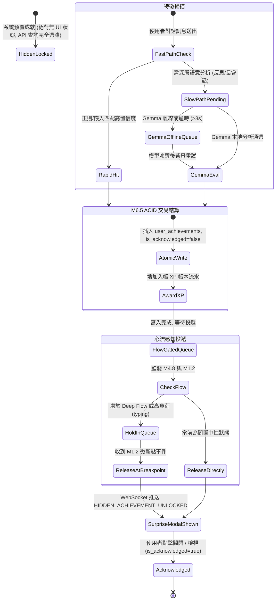

# Data Model: M4.12 隱藏成就驗證引擎

**Branch**: `003-m4-12-hidden-achievement` | **Date**: 2026-10-20 | **Spec**: [spec.md](./spec.md)

本文件定義 M4.12 模組之 SQLite 資料表結構、SQLAlchemy 實體、Pydantic DTO 規範以及狀態生命週期。

---

## 1. 資料庫結構 (SQLite DDL)

### 1.1 隱藏成就原型與定義表 (`hidden_achievements`)

儲存系統預定義與領域擴充之隱藏成就規格。此表資料僅供後端特徵捕捉引擎讀取，未解鎖前**嚴禁直接對客戶端 API 全表回傳**。

```sql
CREATE TABLE IF NOT EXISTS hidden_achievements (
    id VARCHAR(64) PRIMARY KEY,                  -- 成就唯一 ID (如 ha_curious_cartographer_01)
    archetype VARCHAR(32) NOT NULL,              -- 核心成長原型: curiosity, metacognition, restoration, cross_synthesis
    name VARCHAR(128) NOT NULL,                  -- 成就名稱 (解鎖後展示)
    description TEXT NOT NULL,                   -- 詳細探索描述
    flavor_text_template TEXT NOT NULL,          -- 啟發性心理金句模板 (可供 AI 動態注入變數)
    rarity VARCHAR(16) NOT NULL,                 -- 稀有度: rare, epic, legendary
    exp_reward INTEGER NOT NULL,                 -- XP 獎勵額度 (50, 100, 200)
    badge_icon_url VARCHAR(255) NOT NULL,        -- 徽章圖示相對/資源路徑
    eval_rules_json TEXT NOT NULL,               -- 宣告式判定規則 (正則、關鍵字、嵌入閾值)
    is_hidden BOOLEAN NOT NULL DEFAULT 1,        -- 永遠為 1
    created_at TIMESTAMP NOT NULL DEFAULT CURRENT_TIMESTAMP
);

CREATE INDEX IF NOT EXISTS idx_hidden_achievements_archetype ON hidden_achievements(archetype);
```

### 1.2 使用者成就達成記錄表 (`user_achievements`)

紀錄使用者已解鎖之成就與領獎歷程。相容於 M6.2 / M6.5 的 `user_collections` 體系，但包含專屬之心流推播確認與脈絡摘要欄位。

```sql
CREATE TABLE IF NOT EXISTS user_achievements (
    id VARCHAR(64) PRIMARY KEY,                  -- UUID
    user_id VARCHAR(64) NOT NULL,                -- 使用者 ID (全域帳號)
    achievement_id VARCHAR(64) NOT NULL,         -- 外鍵指向 hidden_achievements.id
    origin_role_id VARCHAR(64),                  -- 觸發時的上下文角色 (如 role_csie, 可為空)
    unlocked_at TIMESTAMP NOT NULL DEFAULT CURRENT_TIMESTAMP,
    is_acknowledged BOOLEAN NOT NULL DEFAULT 0,  -- 是否已於客戶端展示過 SurpriseModal
    xp_awarded INTEGER NOT NULL,                 -- 實際發放 XP
    transaction_id VARCHAR(64) NOT NULL,         -- M6.5 ACID 交易流水號
    context_summary TEXT,                        -- 解鎖當下之觸發對話摘錄與個人化金句
    FOREIGN KEY (achievement_id) REFERENCES hidden_achievements(id),
    UNIQUE(user_id, achievement_id)              -- 終身防重複解鎖約束
);

CREATE INDEX IF NOT EXISTS idx_user_achievements_user ON user_achievements(user_id);
CREATE INDEX IF NOT EXISTS idx_user_achievements_ack ON user_achievements(user_id, is_acknowledged);
```

### 1.3 特徵佐證待命佇列表 (`epistemic_evidence_queue`)

當本機 Gemma (M2.2) 處於離線、未載入或推論逾時時，慢軌將候選特徵佐證暫存於此，保證無資料遺失。

```sql
CREATE TABLE IF NOT EXISTS epistemic_evidence_queue (
    id VARCHAR(64) PRIMARY KEY,                  -- UUID
    session_id VARCHAR(64) NOT NULL,             -- 對話 Session ID 或 Reflection ID
    user_id VARCHAR(64) NOT NULL,
    origin_role_id VARCHAR(64),
    source_type VARCHAR(32) NOT NULL,            -- chat_message, session_summary, daily_reflection
    raw_excerpt TEXT NOT NULL,                   -- 本地 L1 文本摘錄 (絕不上雲)
    extracted_themes_json TEXT,                  -- 提取的主題標籤
    concept_leap_depth REAL NOT NULL DEFAULT 0.0,-- 概念跳躍估計值
    proactivity_score REAL NOT NULL DEFAULT 0.0, -- 主動性評分 (0.0~1.0)
    status VARCHAR(16) NOT NULL DEFAULT 'PENDING',-- PENDING, PROCESSING, EVALUATED, FAILED
    retry_count INTEGER NOT NULL DEFAULT 0,
    created_at TIMESTAMP NOT NULL DEFAULT CURRENT_TIMESTAMP,
    processed_at TIMESTAMP
);

CREATE INDEX IF NOT EXISTS idx_evidence_queue_status ON epistemic_evidence_queue(status);
```

---

## 2. 狀態生命週期與轉移 (Lifecycle & State Transitions)



---

## 3. Pydantic 領域實體與 DTO 規範

### 3.1 零洩漏成就查詢模型 (`AchievementWallResponse`)

```python
from pydantic import BaseModel, Field
from typing import Optional, List
from datetime import datetime

class UnlockedAchievementItem(BaseModel):
    id: str
    archetype: str
    name: str
    description: str
    flavor_text: str
    rarity: str  # "rare" | "epic" | "legendary"
    exp_reward: int
    badge_icon_url: str
    origin_role_id: Optional[str] = None
    unlocked_at: datetime
    is_new: bool = False  # 供前端渲染高亮 NEW 微標籤
    context_summary: Optional[str] = None

class AchievementWallResponse(BaseModel):
    user_id: str
    total_unlocked_count: int
    # 嚴格鐵律: 此清單中「絕不包含」任何未解鎖的隱藏成就！
    items: List[UnlockedAchievementItem]
```

### 3.2 WebSocket 解鎖即時推播事件 (`UnlockEventPayload`)

```python
class UnlockEventPayload(BaseModel):
    event_type: str = "HIDDEN_ACHIEVEMENT_UNLOCKED"
    achievement_id: str
    archetype: str
    name: str
    description: str
    flavor_text: str
    rarity: str
    exp_reward: int
    badge_icon_url: str
    origin_role_id: Optional[str]
    unlocked_at: datetime
    context_summary: Optional[str]
```

### 3.3 宣告式原型檢驗規則模型 (`ArchetypeEvalRule`)

```python
class ArchetypeEvalRule(BaseModel):
    achievement_id: str
    archetype: str
    regex_patterns: List[str] = Field(default_factory=list)
    semantic_anchors: List[str] = Field(default_factory=list)
    min_proactivity_score: float = 0.70
    min_concept_leap: float = 0.60
    required_role_context: Optional[str] = None
```
