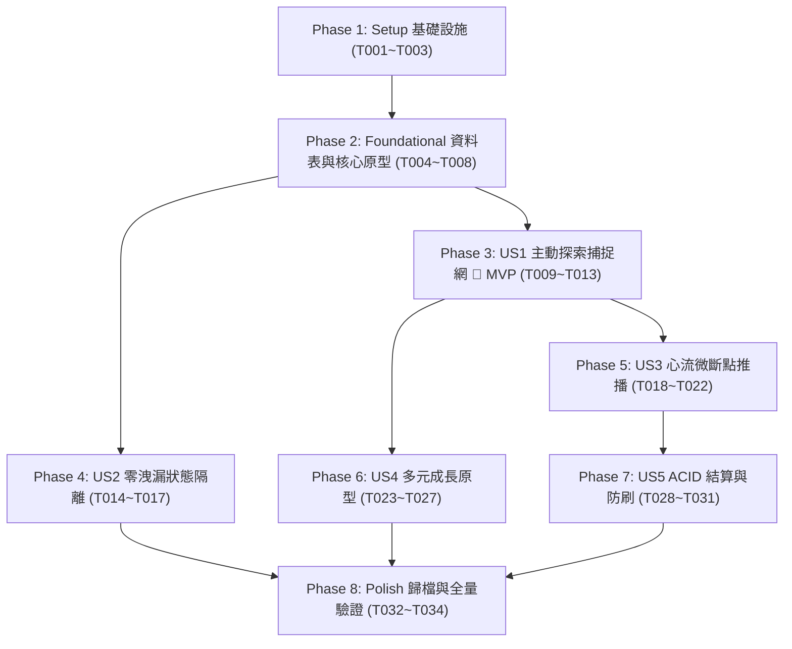

# Tasks: M4.12 隱藏成就驗證引擎 (Hidden Achievement Verification Engine)

**Feature Branch**: `003-m4-12-hidden-achievement`  
**Date**: 2026-10-20  
**Specification**: [spec.md](./spec.md) | **Implementation Plan**: [plan.md](./plan.md)  
**Status**: Ready for Implementation  

---

## Phase 1: Setup (Shared Infrastructure)

**Purpose**: 建立後端模組目錄結構、共享型別與測試環境基礎設施

- [X] T001 建立後端模組目錄 `services/m4_12_hidden_achievement/` 與專屬測試目錄 `testing/m4_12/`
- [X] T002 [P] 於 `services/m4_12_hidden_achievement/__init__.py` 建立模組版本常數與對外導出介面
- [X] T003 [P] 於 `testing/m4_12/conftest.py` 配置 pytest 測試環境與 SQLite 記憶體資料庫共用 Fixtures

---

## Phase 2: Foundational (Blocking Prerequisites)

**Purpose**: 建立資料表綱要、Pydantic DTO 與核心原型宣告式規則庫，作為所有使用者故事的前置依賴

**⚠️ CRITICAL**: 本階段完成前，不得開始任何 User Story 的業務開發

- [X] T004 於 `services/m4_12_hidden_achievement/models.py` 實作 SQLAlchemy 資料庫模型：
  - `HiddenAchievementModel` (`hidden_achievements` 表)：包含主鍵 `id` VARCHAR(64)，`archetype` VARCHAR(32) NOT NULL，`name` VARCHAR(128)，`description` TEXT，`flavor_text_template` TEXT，`rarity` VARCHAR(16)，`exp_reward` INTEGER，`badge_icon_url` VARCHAR(255)，`eval_rules_json` TEXT，`is_hidden` BOOLEAN NOT NULL DEFAULT 1
  - `UserAchievementModel` (`user_achievements` 表)：包含主鍵 `id` VARCHAR(64)，`user_id` VARCHAR(64) NOT NULL，`achievement_id` VARCHAR(64) NOT NULL，`origin_role_id` VARCHAR(64) NULL，`unlocked_at` TIMESTAMP，`is_acknowledged` BOOLEAN NOT NULL DEFAULT 0，`xp_awarded` INTEGER，`transaction_id` VARCHAR(64)，`context_summary` TEXT，以及複合唯一鍵 `UNIQUE(user_id, achievement_id)`
  - `EpistemicEvidenceQueueModel` (`epistemic_evidence_queue` 表)：包含主鍵 `id` VARCHAR(64)，`session_id`，`user_id`，`origin_role_id`，`source_type`，`raw_excerpt` TEXT NOT NULL，`extracted_themes_json` TEXT，`concept_leap_depth` REAL，`proactivity_score` REAL，`status` VARCHAR(16) DEFAULT 'PENDING'，`retry_count` INTEGER DEFAULT 0
- [X] T005 [P] 於 `services/m4_12_hidden_achievement/schemas.py` 實作 Pydantic DTO 與列舉：
  - 定義 `ArchetypeEnum` (`curiosity`, `metacognition`, `restoration`, `cross_synthesis`) 與 `RarityEnum` (`rare`, `epic`, `legendary`)
  - 定義 `HiddenAchievementDTO`、`UnlockedAchievementItem`、`AchievementWallResponse`、`UnlockEventPayload`
- [X] T006 [P] 於 `services/m4_12_hidden_achievement/archetypes.py` 實作四大核心原型宣告式規格常數與 DSL 檢驗模型 `ArchetypeEvalRule`
- [X] T007 於 `services/m4_12_hidden_achievement/router.py` 建立 FastAPI 路由骨架並配置資料庫 Session 依賴注入
- [X] T008 於 `services/main.py` 註冊 `m4_12_router` 於 `/api/achievements` 與 `/api/m4_12` 路徑下

**Checkpoint**: 基礎設施就緒，資料庫表模型與 API 骨架已連通，可開始並行開發各 User Story

---

## Phase 3: User Story 1 - 主動探索與高階概念跳躍之背景無感驗證 (Priority: P1) 🎯 MVP

**Goal**: 實作主動探索特徵捕捉網（M4.12.1），透過快慢雙軌混合架構無感監聽對話與反思，識別使用者自主深鑽概念之火花

**Independent Test**: 模擬對話輸入高階概念自主探究，驗證快軌與慢軌正確識別特徵並觸發達成判定，全程無 L1 明文對話上傳雲端

### Tests for User Story 1 (TDD Mandatory) ⚠️
- [X] T009 [P] [US1] 於 `testing/m4_12/test_dual_track_eval.py` 撰寫快軌正則/嵌入掃描與慢軌語意捕捉之單元測試 (TDD)

### Implementation for User Story 1
- [X] T010 [US1] 於 `services/m4_12_hidden_achievement/feature_trap.py` 實作快軌（Fast Path）輕量正則特徵網與本地向量嵌入比對器（執行時間 <100ms）
- [X] T011 [US1] 於 `services/m4_12_hidden_achievement/feature_trap.py` 實作慢軌（Slow Path）本機 Gemma (M2.2) 語意分析解析器（解析認知跳躍深度與主動提問權重）
- [X] T012 [US1] 於 `services/m4_12_hidden_achievement/evidence_queue.py` 實作本機 Gemma 離線與推論逾時（>3 秒）暫存佇列管理器（寫入 `epistemic_evidence_queue`）與背景出隊補算守護器
- [X] T013 [US1] 於 `services/m4_12_hidden_achievement/service.py` 實作主特徵評估排程器，串接對話完成事件與每日反思提交回呼

**Checkpoint**: User Story 1 獨立可用，系統能在背景無感捕捉深探特徵並完成特徵判定

---

## Phase 4: User Story 2 - 絕對無痕的隱藏狀態與零資料洩漏隔離 (Priority: P2)

**Goal**: 實作 M3.11.3 絕對無 UI 狀態鐵律，於 SQL 查詢層與 API 序列化層強制過濾未解鎖隱藏成就，徹底防止 FOMO 與逆向破解

**Independent Test**: 呼叫 `GET /api/achievements`，驗證回傳清單 100% 排除未解鎖之隱藏成就，進度統計排除未解鎖基數，DOM 零佔位洩漏

### Tests for User Story 2 (TDD Mandatory) ⚠️
- [X] T014 [P] [US2] 於 `testing/m4_12/test_zero_leakage.py` 撰寫 SQL 查詢層與 API Payload 零洩漏驗證測試 (TDD)

### Implementation for User Story 2
- [X] T015 [US2] 於 `services/m4_12_hidden_achievement/router.py` 實作 `GET /api/achievements` 查詢端點之 SQL 強制過濾器（`WHERE is_hidden = 0 OR (is_hidden = 1 AND id IN (SELECT achievement_id FROM user_achievements WHERE user_id = :uid))`）
- [X] T016 [US2] 於 `services/m4_12_hidden_achievement/router.py` 實作成就統計數據之排除邏輯（成就總數分母與已解鎖進度完全排除未達成之隱藏成就）
- [X] T017 [P] [US2] 驗證前端組件 `apps/desktop/src/components/m3_11_gacha/HiddenAchievement/AchievementGrid.tsx` 嚴格 0 佔位 DOM 渲染（未解鎖之隱藏成就 0 個問號節點）

**Checkpoint**: User Story 1 + 2 連通，未解鎖成就零洩漏，達成鐵律級防 FOMO 保護

---

## Phase 5: User Story 3 - 心流感知的無預警即時驚喜廣播與排隊 (Priority: P3)

**Goal**: 實作心流感知微斷點推播（M1.2 門禁）、WebSocket 即時通知廣播與開機單上限（Single Cap）補發機制

**Independent Test**: 模擬深層編程狀態下暫存通知，收到 M1.2 斷點後才推播 `HIDDEN_ACHIEVEMENT_UNLOCKED`，開機積壓時僅彈窗 1 筆

### Tests for User Story 3 (TDD Mandatory) ⚠️
- [X] T018 [P] [US3] 於 `testing/m4_12/test_flow_gated_broadcast.py` 撰寫 M1.2 微斷點門禁、WebSocket 廣播與開機單上限補發測試 (TDD)

### Implementation for User Story 3
- [X] T019 [US3] 於 `services/m4_12_hidden_achievement/surprise_dispatcher.py` 實作心流感知暫存佇列，整合 M4.8 認知負荷與 M1.2 斷點偵測信號 [RISK-04]
- [X] T020 [US3] 於 `services/m4_12_hidden_achievement/surprise_dispatcher.py` 實作 WebSocket 長連線廣播管理器，於微斷點推送 `HIDDEN_ACHIEVEMENT_UNLOCKED` 事件
- [X] T021 [US3] 於 `services/m4_12_hidden_achievement/router.py` 實作 `POST /api/achievements/ack` 處理函式，接收前端確認並更新 `is_acknowledged = 1`
- [X] T022 [US3] 於 `services/m4_12_hidden_achievement/service.py` 實作開機與重新連線時單一精選上限（Single Cap）補發與「NEW」徽章標籤控制邏輯

**Checkpoint**: User Stories 1~3 連通，達成成就時在合適的心流微斷點跳出無預警驚喜彈窗

---

## Phase 6: User Story 4 - 多元成長原型驗證：元認知、生活恢復與跨領域共融 (Priority: P4)

**Goal**: 實作四大核心原型檢驗邏輯（`THE_CURIOUS_CARTOGRAPHER`, `THE_REFRAME_ALCHEMIST`, `THE_SERENDIPITY_SEEKER`, `THE_POLYGLOT_SYNTHESIZER`）及本機 Gemma 動態個性化金句生成

**Independent Test**: 分別注入元認知自省、生活恢復與跨角色思維輸入，驗證各自正確命中對應原型並生成專屬金句

### Tests for User Story 4 (TDD Mandatory) ⚠️
- [X] T023 [P] [US4] 於 `testing/m4_12/test_archetype_rules.py` 撰寫四大核心原型匹配與本機 AI 個性化金句生成測試 (TDD)

### Implementation for User Story 4
- [X] T024 [US4] 於 `services/m4_12_hidden_achievement/archetypes.py` 實作 `THE_REFRAME_ALCHEMIST`（薩提爾冰山元認知自省與心態重構）規則評估器
- [X] T025 [US4] 於 `services/m4_12_hidden_achievement/archetypes.py` 實作 `THE_SERENDIPITY_SEEKER`（注意力恢復 ART 與實體生活探索）規則評估器
- [X] T026 [US4] 於 `services/m4_12_hidden_achievement/archetypes.py` 實作 `THE_POLYGLOT_SYNTHESIZER`（跨角色、跨領域知識融通）規則評估器
- [X] T027 [US4] 於 `services/m4_12_hidden_achievement/feature_trap.py` 實作本機 Gemma 個性化副稱號與啟發金句（`flavor_text`）生成與 `context_summary` 封裝

**Checkpoint**: User Stories 1~4 連通，隱藏成就涵蓋全人成長各面向，具備獨一無二的個人化回顧金句

---

## Phase 7: User Story 5 - M6.5 ACID 交易寫入、XP 激勵與防刷機制 (Priority: P5)

**Goal**: 整合 M6.5 ACID Gatekeeper 完成交易原子寫入、終身防重複解鎖、60 秒冷卻防刷與 M0.4 結構化日誌記錄

**Independent Test**: 併發重複解鎖請求驗證完全冪等（僅 1 筆寫入與給獎），日誌正確發布至 `raw_tracking_logs`

### Tests for User Story 5 (TDD Mandatory) ⚠️
- [X] T028 [P] [US5] 於 `testing/m4_12/test_acid_settlement.py` 撰寫 ACID 交易原子性、併發防重發放與 60 秒冷卻防刷測試 (TDD)

### Implementation for User Story 5
- [X] T029 [US5] 於 `services/m4_12_hidden_achievement/service.py` 整合 M6.5 `XPGatekeeper`，於同一 DB 交易原子寫入 `user_achievements` 與發放 XP
- [X] T030 [US5] 於 `services/m4_12_hidden_achievement/rate_limiter.py` 實作滑動視窗防刷機制（60 秒內重複語意模式不重複計算，單一成就終身限解鎖 1 次）
- [X] T031 [US5] 於 `services/m4_12_hidden_achievement/telemetry.py` 實作 `[R01]` 結構化日誌記錄，將解鎖稽核事件發布至 `raw_tracking_logs`

**Checkpoint**: 經濟系統與交易誠信安全閉環，所有解鎖事件可追溯且具備高併發安全保證

---

## Phase 8: Polish & Cross-Cutting Concerns

**Purpose**: 模組文件化歸檔、登錄表更新與端到端全量驗證

- [X] T032 [P] 於 `docs/modules/M4_12_hidden_achievement_SPEC.md` 撰寫模組架構總結與正式 SPEC 歸檔文件
- [X] T033 [P] 於 `docs/04_module_registry.md` 更新 M4.12 模組登錄表狀態與依賴標籤
- [X] T034 執行 `quickstart.md` 完整端到端驗證流程並確認全量測試通過

---

## Dependencies & Execution Order

### Phase Dependencies



### User Story Dependencies

- **User Story 1 (P1)**: 依賴 Phase 2 完成，為特徵捕捉核心（MVP 範圍）
- **User Story 2 (P2)**: 依賴 Phase 2 完成，可與 US1 平行開發，鎖定查詢層與 DOM 零洩漏
- **User Story 3 (P3)**: 依賴 US1 完成，實作特徵命中後的排隊與推播
- **User Story 4 (P4)**: 依賴 US1 完成，擴充四大核心原型與 AI 個性化金句
- **User Story 5 (P5)**: 依賴 US3 完成，實作推播命中後的資料庫 ACID 結算

---

## Parallel Example: User Story 1

```bash
# 啟動測試任務：
Task: T009 [P] [US1] 於 testing/m4_12/test_dual_track_eval.py 撰寫測試

# 同時撰寫模型與模組定義：
Task: T010 [US1] 於 services/m4_12_hidden_achievement/feature_trap.py 實作快軌正則
Task: T012 [US1] 於 services/m4_12_hidden_achievement/evidence_queue.py 實作離線佇列
```

---

## Implementation Strategy

### MVP First (User Story 1 & 2)

1. 完成 Phase 1: Setup 與 Phase 2: Foundational
2. 完成 Phase 3: User Story 1（快慢雙軌主動探索捕捉網）
3. 完成 Phase 4: User Story 2（SQL 層零洩漏隔離）
4. **驗證與展示**：執行 `test_dual_track_eval.py` 與 `test_zero_leakage.py`，確認特徵命中且未解鎖項目零洩漏。

### Incremental Delivery

1. Foundation + US1 + US2 → 核心捕捉與防 FOMO 隔離就緒 (MVP!)
2. 加入 US3 → 心流微斷點排隊與 WebSocket 驚喜彈窗連通
3. 加入 US4 → 四大原型與本機 Gemma 個性化金句生成
4. 加入 US5 → M6.5 ACID 交易結算與防刷閉環
5. 執行 Phase 8 → 歸檔 SPEC 文件與全量測試通過
